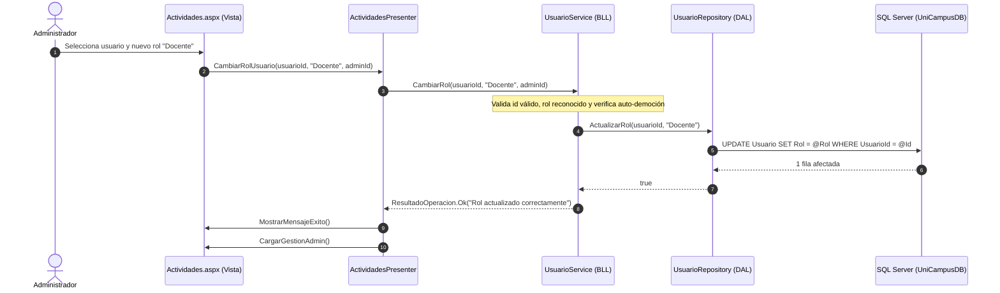

# INFORME TÉCNICO DE ARQUITECTURA Y DESARROLLO

## RETO INTEGRADOR: PLATAFORMA UNICAMPUS

### GESTIÓN DE ACTIVIDADES ACADÉMICAS EN ARQUITECTURA DE TRES CAPAS CON PATRÓN MVP

---

**Institución:** Corporación Universitaria Americana  
**Facultad:** Ingeniería  
**Programa:** Ingeniería de Sistemas  
**Asignatura:** Desarrollo de Aplicaciones Web II  
**Docente:** Ing. Cindy Fuentes  
**Estudiantes:** Arnold Beleño Zuletta y Jazid Kamell Vásquez

**Fecha:** Noviembre de 2026

---

## 1. INTRODUCCIÓN Y CONTEXTO DEL PROYECTO

El desarrollo de soluciones web mantenibles, escalables y seguras exige la aplicación de patrones arquitectónicos que promuevan la separación estricta de responsabilidades. Históricamente, el modelo clásico de desarrollo en ASP.NET Web Forms tendía a concentrar la lógica de interfaz, reglas de negocio y sentencias SQL en el archivo *code-behind* (`.aspx.cs`), generando un alto acoplamiento conocido como código espagueti.

El presente proyecto integrador tiene como propósito la reestructuración y evolución técnica de un formulario monolítico existente hacia una **Arquitectura de Software en Tres Capas (Presentación, Negocio y Datos)**, integrando el patrón de presentación **Model-View-Presenter (MVP)**, consultas parametrizadas con **ADO.NET** y una base de datos relacional robusta en **Microsoft SQL Server**.

---

## 2. ARQUITECTURA DE SOFTWARE (3 CAPAS + MVP)

La solución ha sido modularizada en proyectos independientes dentro de Visual Studio, garantizando que el flujo de dependencias siempre apunte hacia adentro:

```
[ UniCampus.Web (Presentación + MVP) ]
          │          │
          │          ▼
          │   [ UniCampus.Entities (DTOs Transversales) ]
          ▼          ▲
[ UniCampus.BLL (Negocio) ]
          │          │
          ▼          │
[ UniCampus.DAL (Acceso a Datos ADO.NET) ]
          │
          ▼
[ SQL Server (UniCampusDB) ]
```

### 2.1 Responsabilidades por Capa

| Capa | Proyecto | Tecnologías | Responsabilidad Principal |
| :--- | :--- | :--- | :--- |
| **Presentación** | `UniCampus.Web` (`WebApplication4`) | ASP.NET Web Forms, C#, CSS Minimalista | Desplegar la interfaz gráfica de usuario, capturar interacciones y delegar eventos al Presenter. **No contiene sentencias SQL ni reglas de negocio**. |
| **Lógica de Negocio** | `UniCampus.BLL` | C# (.NET Framework 4.8.1) | Implementar y hacer cumplir todas las reglas del dominio académico (validaciones de campos, coherencia de fechas, control de cupos, asignación y seguridad de roles). |
| **Acceso a Datos** | `UniCampus.DAL` | ADO.NET (`SqlConnection`, `SqlCommand`, `SqlTransaction`) | Ejecutar operaciones CRUD y consultas parametrizadas en SQL Server, aislando el motor de base de datos del resto del sistema. |
| **Entidades / DTOs** | `UniCampus.Entities` | C# (.NET Framework 4.8.1) | Definir objetos de transferencia de datos planos (`ActividadDto`, `UsuarioDto`, `InscripcionDto`, `TipoActividadDto`, etc.) para mover información entre capas sin dependencias circulares. |

---

## 3. MODELO DE SEGURIDAD Y MATRIZ DE ROLES

El sistema implementa un control de acceso basado en roles (**RBAC - Role-Based Access Control**), donde cada perfil cuenta con privilegios estrictamente delimitados:

| Característica / Capacidad | Estudiante | Docente | Administrador |
| :--- | :---: | :---: | :---: |
| **Acceso y Autenticación** | Login / Registro libre | Login institucional | Login predefinido / Creado |
| **Consulta y Filtros de Actividades** | ✅ Sí | ✅ Sí | ✅ Sí |
| **Ver Ficha Detallada de Actividad** | ✅ Sí | ✅ Sí | ✅ Sí |
| **Auto-inscripción personal** | ✅ Sí (1 clic) | ✅ Sí | ✅ Sí |
| **Crear y Publicar Actividades** | ❌ Denegado | ✅ Sí | ✅ Sí |
| **Editar y Actualizar Actividades** | ❌ Denegado | ✅ Sí | ✅ Sí |
| **Inscribir a otros participantes** | ❌ Denegado | ✅ Sí | ✅ Sí |
| **Cancelar inscripción de terceros** | ❌ Denegado | ✅ Sí | ✅ Sí |
| **Publicar Reseñas y Calificaciones** | ✅ Sí (1-5 ★) | ✅ Sí | ✅ Sí |
| **Eliminar Reseña propia** | ✅ Sí | ✅ Sí | ✅ Sí |
| **Moderar / Eliminar Reseña ajena** | ❌ Denegado | ❌ Denegado | ✅ Sí (Global) |
| **Eliminar Actividad Académica** | ❌ Denegado | ✅ Sí | ✅ Sí (Global) |
| **Panel de Control de Administrador** | ❌ Oculto | ❌ Oculto | ✅ **Exclusivo** |
| **Gestión de Usuarios y Cambio de Roles** | ❌ Denegado | ❌ Denegado | ✅ **Exclusivo** |
| **Gestión de Catálogo de Tipos** | ❌ Denegado | ❌ Denegado | ✅ **Exclusivo** |

### 3.1 Capacidades Exclusivas del Administrador

A diferencia del docente (cuyo alcance es pedagógico y operativo sobre sus eventos), el **Administrador** posee superpoderes de gobernanza global:

1. **Pestaña Administrativa:** Acceso directo al *Panel de Control de Administrador* mediante un conmutador de navegación en la cabecera.
2. **Gobernanza de Cuentas y Roles:** Puede listar todas las cuentas registradas en la base de datos y cambiar dinámicamente el rol de cualquier usuario (`Estudiante`, `Docente`, `Administrador`) mediante un menú desplegable y botón de confirmación.
3. **Reglas de Seguridad y Auto-Protección:**
   - Un administrador **no puede auto-demoverse** (revocar su propio rol de administrador mientras tiene la sesión activa).
   - Un administrador **no puede auto-eliminarse** del sistema para evitar que el sistema quede huérfano de administradores.
4. **Gestión del Catálogo Dinámico de Categorías (`TipoActividad`):**
   - El administrador puede crear nuevas categorías (ej: *Hackathon*, *Coloquio*, *Feria Científica*) o eliminar tipos obsoletos.
   - Las categorías creadas por el admin se propagan de inmediato al catálogo disponible para los docentes al publicar eventos.

---

## 4. IMPLEMENTACIÓN DEL PATRÓN MODEL-VIEW-PRESENTER (MVP)

A diferencia de MVC donde el controlador rige el ciclo HTTP completo, en ASP.NET Web Forms el patrón **MVP** es la arquitectura recomendada para desacoplar el ciclo de eventos del formulario web:

1. **La Vista (`View`):**
   - Interfaces de vista: `IActividadesView.cs` e `ILoginView.cs`.
   - Las páginas `Actividades.aspx.cs` y `login.aspx.cs` implementan estos contratos. Únicamente leen controles visuales y presentan datos.
2. **El Presentador (`Presenter`):**
   - Clases `ActividadesPresenter.cs` y `LoginPresenter.cs`.
   - Reciben la interfaz de la vista y coordinan los servicios de negocio (`ActividadService`, `InscripcionService`, `UsuarioService`, `TipoActividadService`, `ResenaService`).
3. **El Modelo (`Model`):**
   - DTOs tipados en `UniCampus.Entities`.



---

## 5. MODELO DE DATOS Y PERSISTENCIA (UniCampusDB)

El modelo de datos relacional se crea mediante el script reproducible **`03_BaseDatos.sql`**, incorporando claves primarias `IDENTITY`, claves foráneas con eliminación en cascada donde corresponde, restricciones de chequeo (`CHECK`) y restricciones de unicidad (`UNIQUE`).

### 5.1 Diccionario de Tablas Principales

- **`dbo.Usuario`:** Cuentas con nombre, correo institucional (`UNIQUE`), contraseña (`Clave`), programa académico, rol (`Estudiante`, `Docente`, `Administrador`) y teléfono.
- **`dbo.TipoActividad`:** Catálogo de categorías (Taller, Conferencia, Seminario, Simposio, Webinar, etc.).
- **`dbo.ActividadAcademica`:** Entidad central que registra los eventos formativos con título, descripción, tipo, fechas, horario, modalidad, lugar, cupos disponibles y estado.
- **`dbo.Inscripcion`:** Relación asociativa entre usuario y actividad con restricción `UNIQUE (ActividadId, UsuarioId)` para evitar sobre-inscripciones duplicadas.
- **`dbo.Resena`:** Permite registrar valoraciones numéricas (1 a 5) y comentarios cualitativos por actividad.

---

## 6. GUÍA DE EXPORTACIÓN E IMPORTACIÓN DE BASE DE DATOS SIN ERRORES

Para transferir la base de datos `UniCampusDB` desde su equipo local a otro equipo sin sufrir errores de versión, permisos ni rutas de archivos `.mdf`/`.ldf`, siga este procedimiento documentado:

### Método Recomendado (100% Portable): Generación de Script con Esquema y Datos

1. Abra **SQL Server Management Studio (SSMS)**.
2. En el *Explorador de objetos*, haga clic derecho sobre la base de datos `UniCampusDB`.
3. Seleccione **Tareas (Tasks)** $\rightarrow$ **Generar scripts... (Generate Scripts...)**.
4. En el asistente:
   - Pantalla 1: Haga clic en **Siguiente**.
   - Pantalla 2 (Seleccionar objetos): Seleccione *"Girar scripts de toda la base de datos y todos los objetos"* $\rightarrow$ **Siguiente**.
   - Pantalla 3 (Opciones de scripting):
     - Seleccione *"Guardar en una ubicación específica"* y elija guardar como un solo archivo `.sql`.
     - **PASO CRÍTICO:** Haga clic en el botón **Avanzado (Advanced)**.
     - Busque la opción **"Tipos de datos que se van a incluir en el script" (Types of data to script)** y cámbiela de *"Solo esquema"* a **"Esquema y datos" (Schema and data)**.
     - Compruebe que la opción *"Creación de scripts para el motor de base de datos"* sea compatible con la versión destino.
     - Haga clic en **Aceptar** y luego en **Siguiente** hasta finalizar.
5. **Para insertar en el otro equipo:**
   - Abra el script generado en el SSMS del nuevo equipo y pulse **Ejecutar (F5)**.

---

## 7. CREDENCIALES DE PRUEBA PRECONFIGURADAS

Al ejecutar `03_BaseDatos.sql`, la base de datos queda inmediatamente lista con los 3 perfiles principales:

| Rol | Correo / Usuario | Contraseña | Capacidades visibles |
| :--- | :--- | :--- | :--- |
| **Administrador** | `admin@unicampus.edu` | `admin123` | Control total, Panel Admin, gestión de usuarios, catálogo y moderación global. |
| **Docente** | `docente@americana.edu.co` | `docente123` | Publicar/editar actividades, ver lista de inscritos, inscribir alumnos. |
| **Estudiante** | `estudiante@americana.edu.co` | `123456789` | Consultar catálogo, auto-inscribirse (1 clic) y calificar actividades con reseñas. |

---

## 8. INSTRUCCIONES DE COMPILACIÓN Y EJECUCIÓN

1. **Abrir la solución:**
   - Abrir `WebApplication4/UniCampus.sln` en Visual Studio 2022 / 2026.
2. **Verificar cadena de conexión:**
   - En `WebApplication4/Web.config`, la cadena apunta por defecto a `Data Source=.;Initial Catalog=UniCampusDB;Integrated Security=True;TrustServerCertificate=True;`.
3. **Ejecutar:**
   - Presionar **F5** (IIS Express). El sistema abrirá `login.aspx` solicitando autenticación o permitiendo el registro de una nueva cuenta.
